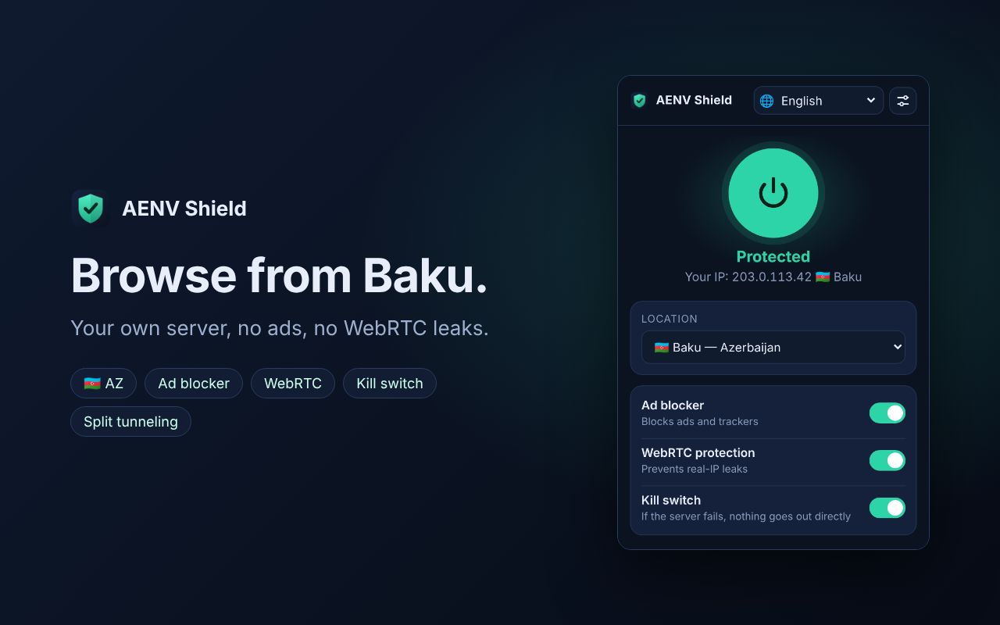

# AENV Shield

Private proxy client + ad blocker for Chrome, Edge, Brave and other Chromium browsers.
Route your browser through **your own server** (for example a VPS in Baku, so websites see an
🇦🇿 Azerbaijani IP), block ads and trackers, and stop WebRTC from leaking your real IP.



> AENV Shield is a client only. It does not sell or operate a VPN service — traffic goes only
> to servers you add yourself. There is no account and no telemetry.

## Features

| | |
|---|---|
| One-click connect | Big power button, location picker, badge shows the active country (`AZ`) |
| Own servers | HTTPS (recommended), HTTP or SOCKS5 proxies; username/password answered automatically |
| Connection codes | `server/install.sh` prints an `aenv-shield:…` code — paste it, done |
| Ad blocker | Built-in rules for ad networks and trackers (declarativeNetRequest, works offline), empty ad slots hidden, per-page counter, **pause on this site** |
| WebRTC protection | Stops WebRTC from exposing the real IP |
| Kill switch | If the server fails: **on** → nothing leaves the browser; **off** → disconnects openly and shows an error. It never falls back silently. |
| Split tunneling | Bypass list: e.g. your bank keeps using your real IP |
| Auto-connect | Reconnect when the browser starts |
| IP check | Shows the IP/country websites see (optional, via ipwho.is) |
| 5 languages | Azərbaycanca, English, Türkçe, Deutsch, Español — live picker 🌐 |

## Install

**From the store** (once published): Chrome Web Store / Microsoft Edge Add-ons — see [docs/STORE.md](docs/STORE.md).

**Manually (developer mode):**
1. Download `aenv-shield-<version>.zip` from [Releases](../../releases) (or the CI artifact) and unzip it.
2. Open `chrome://extensions` (Edge: `edge://extensions`), switch on **Developer mode**.
3. **Load unpacked** → choose the unzipped folder.

## Get an Azerbaijani IP

1. Rent a small Ubuntu 22.04/24.04 VPS **in Baku** (see [server/README.md](server/README.md)).
2. On the server: `sudo bash install.sh --country AZ --name "Baku"`
3. Copy the printed `aenv-shield:…` code → extension **Settings → Import connection code**.
4. Click the power button. The popup should show `🇦🇿 Baku`.

## Development

```bash
npm install          # puppeteer-core for the browser tests
npm test             # unit + consistency tests (Node 22)
npm run e2e          # loads the real extension in Chrome against a local fake proxy
npm run rules        # rebuild extension/rules/ads.json from domains.txt
npm run pack         # dist/aenv-shield-<version>.zip
node tools/make_store_art.mjs   # store screenshots rendered from the real UI
```

Layout: `extension/` (MV3 source), `server/` (VPS setup), `tests/`, `tools/`, `docs/`, `store-assets/`.

## Legal

- [End user license](LICENSE.txt) · [Privacy policy](docs/privacy-policy.md)
- Use your own servers in line with the laws of the countries involved and the terms of the sites you visit.

© 2026 Vusal Aliyev
